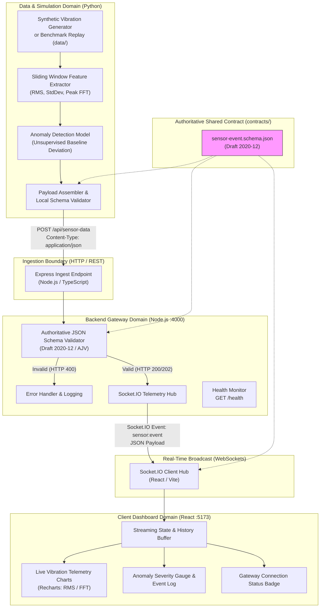

# Resonance — System Architecture Specification

## 1. Architectural Overview

**Resonance** is a modular, event-driven anomaly monitoring platform engineered to ingest, process, evaluate, and visualize acoustic and vibration telemetry for civil infrastructure (such as bridges, support pillars, and overpasses).

In its initial implementation, Resonance operates as a **software simulation and anomaly monitoring prototype**. It does not perform certified structural engineering analysis or crack verification; rather, it detects statistical and spectral distribution anomalies in high-frequency vibration signals.

---

## 2. System Architecture Diagram

---

## 3. Module Responsibilities and Boundaries

| Directory | Primary Technology | Core Ownership | Validation Responsibility |
| :--- | :--- | :--- | :--- |
| `contracts/` | JSON Schema Draft 2020-12 | Single source of truth for telemetry event contracts, examples, and version definitions. | Enforces rigid typing and boundaries across all tiers. |
| `sensor_sim/` | Python (NumPy, SciPy, Scikit-learn) | Data generation, sliding windowing, feature extraction (RMS, FFT), baseline anomaly scoring, and HTTP delivery. | Validates generated payloads against schema prior to network dispatch. |
| `server/` | Node.js, Express, TypeScript, Socket.IO | Telemetry ingestion gateway, schema enforcement, rate policing, service health, and real-time WebSocket distribution. | Authoritatively validates every incoming payload against `contracts/sensor-event.schema.json`. Drops invalid payloads with HTTP 400. |
| `client/` | React, Vite, TypeScript, Tailwind, Recharts | Interactive monitoring dashboard, real-time visualization of vibration signatures, anomaly alerts, and connection resilience. | Enforces TypeScript type definitions mirrored from the JSON contract. |
| `tests/` | Pytest, JSON Schema Validator | End-to-end and boundary contract tests ensuring zero divergence across language environments. | Verifies both valid fixtures and comprehensive negative cases. |

---

## 4. End-to-End Data Flow

1. **Window Acquisition:** `sensor_sim` generates or reads time-series acceleration records over discrete time windows (e.g. 500ms–1000ms).
2. **Feature Extraction:**
   - **Root Mean Square ($RMS$):** Quantifies total signal energy.
   - **Standard Deviation ($\sigma$):** Quantifies signal variation around mean acceleration.
   - **Dominant Frequency ($f_{dom}$):** Identifies peak spectral energy via FFT.
3. **Inference & Scoring:**
   - Features are scored against an unsupervised baseline (e.g., Isolation Forest).
   - Anomaly severity is mapped to an unbounded non-negative continuous `anomaly_score` ($\ge 0.0$).
   - A categorical `status` (`"normal"` or `"anomaly"`) is assigned based on the configured decision threshold.
4. **Ingest Dispatch:** The simulator packages the event, assigns a monotonically increasing `sequence` number, and issues an HTTP `POST` to `http://localhost:4000/api/sensor-data`.
5. **Gateway Validation & Broadcast:**
   - Node.js backend receives the JSON body.
   - The body is validated against `contracts/sensor-event.schema.json`.
   - If valid, the backend responds with HTTP 200/202 and broadcasts `sensor:event` via Socket.IO to connected browser clients.
   - If invalid, the backend rejects the request with HTTP 400 and does not broadcast.
6. **Dashboard Visualization:**
   - The React client updates its sliding-window time series buffer.
   - Real-time charts render the newest RMS and FFT readings.
   - If `status == "anomaly"`, an alert row is appended to the event timeline.

---

## 5. Development Network Topology & Planned Ports

These ports represent the planned defaults configured in `.env.example`:

| Service | Protocol | Planned Default Address | Description |
| :--- | :--- | :--- | :--- |
| **Backend Gateway** | HTTP / WebSocket | `http://localhost:4000` | Express REST ingest + Socket.IO server |
| **Frontend Client** | HTTP | `http://localhost:5173` | Vite development server for React UI |
| **Sensor Simulator** | Outbound HTTP Client | *Ephemeral client port* | Dispatches to backend port 4000 |

---

## 6. Known Limitations of Software Simulation

1. **Prototype Telemetry Only:** Resonance is a demonstration and anomaly-monitoring prototype. It must not be cited as certified bridge crack detection or physical structural safety verification.
2. **Synthetic / Public Datasets:** Vibration waveforms in Stage 1 originate from public datasets or synthetic mathematical models rather than calibrated piezo-electric accelerometers installed on in-service bridges.
3. **Transient In-Memory Messaging:** Socket.IO pushes live events directly to active browser sessions. No persistent message broker (e.g. Kafka/RabbitMQ) or time-series database (e.g. InfluxDB/Timescale) is introduced in Phase 1.
