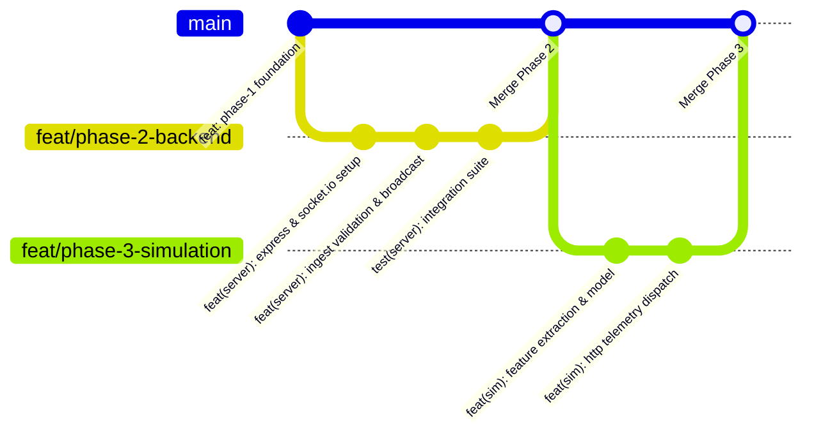

# Resonance — Git Collaboration & Branching Workflow

## 1. Collaboration Philosophy

Resonance is developed collaboratively across sequential hackathon development phases. Because different developers specialize in different phases (Architecture -> Backend Gateway -> ML & Simulation Engine -> Frontend Dashboard -> Physical Hardware Integration), our Git process emphasizes:
- **Zero integration conflicts** via strict module ownership and boundaries.
- **Contract-first stability:** No developer alters `contracts/` without team consensus.
- **Clean history and branch hygiene:** Never commit secrets, virtual environments, build artifacts, or multi-gigabyte raw datasets.

---

## 2. Phase-by-Phase Sequential Workflow

Each developer follows this standard sequential lifecycle:



### Step-by-Step Procedure

1. **Pull Latest Main:**
   Ensure your local checkout reflects the merged state of prior phases:
   ```bash
   git fetch origin
   git checkout main
   git pull origin main
   ```

2. **Create a Phase Feature Branch:**
   Name your branch according to the phase and scope:
   ```bash
   git checkout -b feat/phase-X-<scope>
   # e.g., git checkout -b feat/phase-2-backend-gateway
   ```

3. **Confine Edits to Assigned Scope:**
   Work strictly inside your designated module directory (`server/`, `sensor_sim/`, `client/`). Do not touch other modules without prior architectural review.

4. **Run Contract & Unit Tests:**
   Validate that your changes maintain contract compliance before staging:
   ```bash
   npm run test:contract
   npm run validate:examples
   ```

5. **Pre-Commit Hygiene Review:**
   Inspect staged changes to guarantee no sensitive data, local `.env` keys, or binary datasets are tracked:
   ```bash
   git status
   git diff --staged
   git diff --check
   ```

6. **Descriptive Conventional Commit:**
   Commit using the conventional commit format:
   ```bash
   git commit -m "feat(server): implement POST /api/sensor-data with schema validation"
   ```

7. **Push & Pull Request / Merge:**
   Push your feature branch to GitHub and create a Pull Request:
   ```bash
   git push origin feat/phase-2-backend-gateway
   ```
   *Note: Merge only after CI tests pass and review criteria are satisfied.*

8. **Handoff Verification:**
   Switch back to `main`, pull the merged result, and confirm clean tests before tagging the next developer.

---

## 3. Strict Safety Rules & Guardrails

- **No Destructive Operations:** Never run `git reset --hard`, `git push --force`, or prune branches without explicit alignment with the project lead.
- **Protected Master Contract:** `contracts/sensor-event.schema.json` is protected. Any revision requires a major/minor version discussion and updates across all three consumers.
- **Repository Cleanliness:** Respect `.gitignore`. If a large `.csv` or `.bin` dataset is placed in `data/`, verify that `git status` does not stage it. Only `.gitkeep` is tracked.
